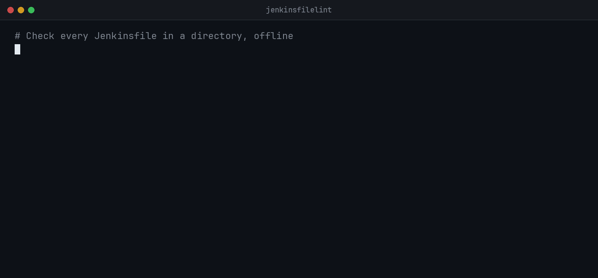

# Jenkinsfile Lint

[](https://github.com/jenkinsci/jenkinsfilelint/actions/workflows/main.yml)
[](https://codecov.io/gh/jenkinsci/jenkinsfilelint)
[](https://pypi.org/project/jenkinsfilelint)

Catch Jenkinsfile syntax errors before they break your CI.

`jenkinsfilelint` checks your Declarative Pipeline syntax offline, with no
Jenkins at all, or with your Jenkins's own validator
([`/pipeline-model-converter/validate`](https://www.jenkins.io/doc/book/pipeline/development/#linter))
when you configure one. It's primarily a [pre-commit](https://pre-commit.com/)
hook, but also works as a standalone CLI tool.

> 📖 Read the [official blog post](https://www.jenkins.io/blog/2026/06/08/jenkinsfilelint-pre-commit/) for the story behind this tool.



## Quick Start

```bash
pip install jenkinsfilelint
jenkinsfilelint Jenkinsfile
jenkinsfilelint .          # every Jenkinsfile in this directory
jenkinsfilelint --audit .  # and look for security problems
```

That works as is: with no Jenkins server configured, files are checked
offline. Then add the pre-commit hook (see [below](#pre-commit-hook)) or keep
using the [CLI](https://jenkinsci.github.io/jenkinsfilelint/usage/#cli).

## Pre-commit Hook

Add the hook to your `.pre-commit-config.yaml` and install. Once configured,
every commit that touches a Jenkinsfile is automatically validated.

```yaml
# .pre-commit-config.yaml
repos:
  - repo: https://github.com/jenkinsci/jenkinsfilelint
    rev: # use the latest version
    hooks:
      - id: jenkinsfilelint-offline
```

```bash
pip install pre-commit
pre-commit install
```

## Documentation

Everything else is on the [documentation site](https://jenkinsci.github.io/jenkinsfilelint/): [install](https://jenkinsci.github.io/jenkinsfilelint/install/), [usage](https://jenkinsci.github.io/jenkinsfilelint/usage/), [pre-commit](https://jenkinsci.github.io/jenkinsfilelint/pre-commit/), [configuration](https://jenkinsci.github.io/jenkinsfilelint/configuration/), [security](https://jenkinsci.github.io/jenkinsfilelint/security/), [how it works](https://jenkinsci.github.io/jenkinsfilelint/how-it-works/) and the [security audit](https://jenkinsci.github.io/jenkinsfilelint/audit/).

## Contributing

See [CONTRIBUTING.md](CONTRIBUTING.md).

## License

MIT — see [LICENSE](LICENSE).
