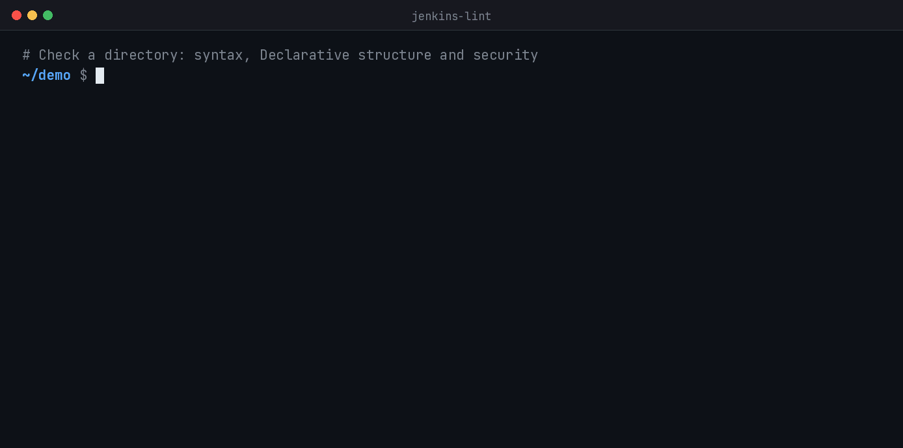

# jenkins-lint

Catch Jenkinsfile mistakes and security problems before they reach your CI.

`jenkins-lint` checks Jenkinsfiles and shared library files offline, in
milliseconds, with no Jenkins, Docker or JVM: Groovy syntax and Declarative
Pipeline structure, with the wording of Jenkins's own validator, and security
problems such as secrets and pull request titles interpolated into shell
steps, with fixes. `--remote` also validates the files with your Jenkins,
which knows its plugins. It is one small binary, for pre-commit, CI and the
command line.

> [!NOTE]
> Formerly `jenkinsfilelint`: see [Migrating to 2.0](migrating.md).

## Quick Start

```bash
pip install jenkins-lint
jenkins-lint Jenkinsfile  # syntax, Declarative structure and security
jenkins-lint .            # every Jenkinsfile and shared library file here
```

That works as is: files are checked offline, and `--remote` also checks them
with your own Jenkins. Then add the pre-commit hook (see [Pre-commit hook](pre-commit.md)) or keep
using the [CLI](usage.md#cli).

## Security rules

<!-- rules -->

## Demo


